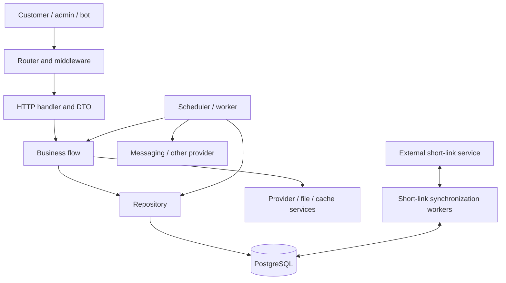

# Backend codebase guide

This guide is a map for reading and navigating the Jazebeh backend. It explains where requests enter, where decisions are made, where data is persisted, and how background work connects to the HTTP API. Paths below are relative to this guide. The implementation and migrations remain the source of truth if a description becomes outdated.

## 1. What the backend does

The Go application serves customer, administrator and bot APIs for campaigns, bundles, audiences, wallet and payments, media and reporting. A campaign describes a message and its target audience; a bundle groups related campaigns and carries shared context. Campaigns can target an audience by standard criteria, an uploaded Excel file, or smart targeting. Background workers prepare calculations, send messages, collect results and maintain derived reports.

The central technologies are Fiber for HTTP, GORM and PostgreSQL for persistent state, and Redis for cache and other configured coordination. External services include messaging and payment providers, an AI client for tag evaluation, and an optional separate short-link service. The [project README](../../README.md) covers setup and configuration; [go.mod](../../go.mod) specifies the Go toolchain and dependencies.

## 2. The picture to keep in mind

The arrows show common dependencies, not an absolute rule: some flows use GORM or files directly, and some schedulers contain substantial orchestration and provider code. A model is not automatically an API response, and a worker is not necessarily an HTTP handler. Follow the concrete constructor and calls when a path differs from this overview.

| Layer | Purpose | Start here |
| --- | --- | --- |
| Startup | Load configuration, construct dependencies, start workers and server | [main.go](../../main.go) |
| HTTP routing | Connect routes to handlers and attach middleware | [app/router/routes.go](../../app/router/routes.go) |
| Middleware and authorization | Authentication, permissions, request handling and metrics | [app/middleware](../../app/middleware), [app/authorization](../../app/authorization) |
| DTOs | HTTP-facing request and response shapes and validation tags | [app/dto](../../app/dto) |
| Handlers | Bind input, obtain identity, call flows, map errors and responses | [app/handlers](../../app/handlers) |
| Business flows | Coordinate domain validation, decisions, transactions and external work | [business_flow](../../business_flow) |
| Repositories | Query and update persistent data, often through GORM | [repository](../../repository) and [interfaces.go](../../repository/interfaces.go) |
| Models | Database entities, statuses, snapshots and domain helpers | [models](../../models) |
| Workers | Poll, claim and execute background jobs; run delivery schedulers | [app/scheduler](../../app/scheduler) |
| Integrations | Token, notification, payment-provider and AI clients | [app/services](../../app/services) and platform clients in [app/scheduler](../../app/scheduler) |
| Database history | SQL tables, indexes, constraints, triggers and views | [migrations](../../migrations) and its [README](../../migrations/README.md) |

## 3. How the process starts

1. [`main`](../../main.go) loads [production configuration](../../config/production.go), initializes observability and logging, and calls `initializeApplication`.
2. `initializeApplication` opens PostgreSQL and initializes cache, then constructs repositories, provider services, business flows and handlers. This is the best place to see which concrete implementation is injected into an interface. It also constructs and starts configured workers and records stop functions.
3. The router's `SetupRoutes` registers middleware and endpoints; the server starts and later performs graceful shutdown. Worker startup is conditional on configuration, so the presence of a scheduler in the repository does not imply it runs in every deployment.

Configuration names and defaults belong in [config/production.go](../../config/production.go) and [env.template](../../env.template). Do not put real secrets in documentation. For deployment topology and runtime requirements, use [docs/README.md](../README.md) and [RUN.md](../../RUN.md).

## 4. Trace a request from URL to database

For example, follow creation of a customer campaign:

1. In [routes.go](../../app/router/routes.go), find `POST /api/v1/campaigns/`: the campaign route group installs customer authentication and calls `CampaignHandler.CreateCampaign`.
2. In [campaign_handler.go](../../app/handlers/campaign_handler.go), `CreateCampaign` binds JSON into `dto.CreateCampaignRequest`, validates it, obtains the authenticated customer ID from request locals, creates a request context and calls the campaign flow. It translates the result or error into an HTTP response.
3. In [campaign_dto.go](../../app/dto/campaign_dto.go), inspect request and response fields. The handler's authenticated customer ID is the identity used by the flow; do not assume an arbitrary ID supplied by a client is trusted.
4. In [campaign_flow.go](../../business_flow/campaign_flow.go), `CreateCampaign` and its helpers check domain rules and coordinate persistence. Some validations and related writes occur inside a transaction.
5. Follow the injected repository calls to [campaign_repository.go](../../repository/campaign_repository.go), [base.go](../../repository/base.go), [campaign.go](../../models/campaign.go), and the relevant SQL migration. A model describes Go-side data; SQL constraints, indexes and triggers may add important behavior that is not visible in the model alone.

The same reading pattern works for a bug: **route → middleware → handler → flow → repository/model → migration**, then follow workers or providers if the operation queues asynchronous work. Use [campaign-flow.md](campaign-flow.md) for the detailed campaign path.

## 5. How asynchronous work differs

An API can create a durable job and return before the expensive work is done. A scheduler later claims it, runs a flow or worker routine and persists a result. For a concrete example, trace `POST /api/v1/campaigns/:uuid/smart-targeting/capacity-calculations` through [campaign_handler.go](../../app/handlers/campaign_handler.go), `Start` in [smart_targeting_capacity_flow.go](../../business_flow/smart_targeting_capacity_flow.go), the calculation repository, and [smart_targeting_capacity_scheduler.go](../../app/scheduler/smart_targeting_capacity_scheduler.go). The scheduler claims rows and passes the calculation ID and lease start time to the executor.

Many queues use row locks, `SKIP LOCKED`, lease timestamps or tokens so replicas can share work and recover after a crash. The exact guard differs by queue: read its repository and worker rather than assuming all workers have the same retry or stale-lease policy. In particular, a successful request to enqueue a job is not proof that its calculation or external operation has completed.

Useful worker families include:

- Smart tag evaluation, capacity, test sampling and execution calculations: the corresponding `bundle_tag_evaluation_scheduler.go` and `smart_targeting_*_scheduler.go` files under [app/scheduler](../../app/scheduler).
- Campaign sending and provider status: `sms_campaign_scheduler.go`, `bale_campaign_scheduler.go`, `rubika_campaign_scheduler.go` and `splus_campaign_scheduler.go` in that directory.
- Action uploads, audience report exports, tag performance and refunds: the `bundle_action_file`, `campaign_audience_report`, `tag_test_performance` and `campaign_refund_reconciliation` schedulers.

## 6. Domain map: where to look for a feature

| Question | Main entry points | Related details |
| --- | --- | --- |
| How are bundles created and displayed? | [bundle_flow.go](../../business_flow/bundle_flow.go), [bundle_handler.go](../../app/handlers/bundle_handler.go) | [Bundle flow guide](bundle-flow.md), [bundle model](../../models/bundle.go), [bundle repository guide](bundle-repository.md) |
| How does a campaign move from draft through approval and execution? | [campaign_flow.go](../../business_flow/campaign_flow.go), [campaign_admin_flow.go](../../business_flow/campaign_admin_flow.go), [campaign_bot_flow.go](../../business_flow/campaign_bot_flow.go) | [Lifecycle guide](campaign-lifecycle.md), [campaign model](../../models/campaign.go), [execution repository guide](campaign-execution-repository.md) |
| How are tags discovered and selected? | [smart_targeting_flow.go](../../business_flow/smart_targeting_flow.go), [campaign_selected_tag_repository.go](../../repository/campaign_selected_tag_repository.go) | [Tag selection guide](smart-targeting-flow.md), [selected-tag repository guide](campaign-selected-tag-repository.md) |
| How is an audience counted or selected? | [smart_targeting_capacity_flow.go](../../business_flow/smart_targeting_capacity_flow.go), [smart_targeting_sampling_flow.go](../../business_flow/smart_targeting_sampling_flow.go), [smart_targeting_execution_calculation_flow.go](../../business_flow/smart_targeting_execution_calculation_flow.go) | [Capacity](smart-targeting-capacity-flow.md), [sampling](smart-targeting-sampling-flow.md), [execution calculation](smart-targeting-execution-calculation-flow.md), [audience query guide](smart-targeting-audience-repository.md) |
| How is AI tag scoring queued and resumed? | [bundle_tag_evaluation_flow.go](../../business_flow/bundle_tag_evaluation_flow.go), [smart_tag_openai_client.go](../../app/services/smart_tag_openai_client.go) | [Evaluation flow guide](bundle-tag-evaluation-flow.md), [evaluation repository guide](bundle-tag-evaluation-repository.md) |
| How are uploaded actions and audience reports processed? | [bundle_action_flow.go](../../business_flow/bundle_action_flow.go), [campaign_audience_report_job_flow.go](../../business_flow/campaign_audience_report_job_flow.go) | [Action guide](bundle-action-flow.md), [report job guide](campaign-audience-report-job-flow.md) |
| Where are pricing and configuration values stored? | [campaign_flow.go](../../business_flow/campaign_flow.go), [page_price_repository.go](../../repository/page_price_repository.go), [platform_base_price_repository.go](../../repository/platform_base_price_repository.go), [segment_price_factor_repository.go](../../repository/segment_price_factor_repository.go) | [Page-price](page-price-repository.md), [platform-base-price](platform-base-price-repository.md), [segment-price-factor](segment-price-factor-repository.md) guides |
| How do wallet, payments and refunds work? | [payment_flow.go](../../business_flow/payment_flow.go), [payment_admin_flow.go](../../business_flow/payment_admin_flow.go), [crypto_payment_flow.go](../../business_flow/crypto_payment_flow.go) | [wallet model](../../models/wallet.go), [campaign flow guide](campaign-flow.md), [refund queue guide](campaign-refund-reconciliation-repository.md) |
| Where is authentication and access control? | [signup_flow.go](../../business_flow/signup_flow.go), [login_flow.go](../../business_flow/login_flow.go), [auth_middleware.go](../../app/middleware/auth_middleware.go) | [Admin login](../../business_flow/login_admin_flow.go), [bot login](../../business_flow/login_bot_flow.go), [authorization middleware](../../app/middleware/authorization_middleware.go), [access control flow](../../business_flow/access_control_flow.go) |
| How are short links and clicks handled? | [short_link_visit_flow.go](../../business_flow/short_link_visit_flow.go), [external_short_link_publication.go](../../business_flow/external_short_link_publication.go) | [Standalone service README](../../external-shortlink/README.md), [click model](../../models/short_link_click.go), synchronization workers in `app/scheduler` |

## 7. How the campaign pieces relate

Start with a customer-owned bundle and a campaign. Optional bundle tag evaluation generates tag scores, which can inform tag discovery. Smart-targeting selection stores the campaign's chosen tags; a capacity calculation evaluates an eligible unique audience. For a test campaign, a sampling preview selects concrete members and estimates cost. For execution, an execution calculation prepares a concrete proposal. Finalization validates current inputs and establishes the necessary reservations and financial state; admin approval and the appropriate scheduler continue the lifecycle.

The distinction between **selection**, **preview/proposal**, **reservation**, **materialized bundle audience** and **delivery** is essential. They occur at different times and have different invariants. A selected tag is not a delivered message; a ready proposal can become stale; a reservation must be checked under the relevant locks before materialization. The [business-flow review map](../../business_flow/BUSINESS_FLOW_REVIEW_GUIDE.md) and [smart-targeting API documentation](../smart-targeting-api.md) provide more detail.

Similarly, a wallet balance snapshot, a transaction and a campaign status answer different questions. Follow the transaction and wallet locks when investigating money; review the [campaign flow guide](campaign-flow.md), [admin flow guide](campaign-admin-flow.md) and [refund reconciliation guide](campaign-refund-reconciliation-repository.md) together.

## 8. Persistence, transactions and derived data

Repositories often embed the generic `BaseRepository`, but not all do. [repository-base.md](repository-base.md) explains `getDB`, `getDBForWrite` and `WithTransaction`. A context carrying a transaction lets cooperating repository calls participate in the same commit; check each implementation before assuming it honors that context. A row lock only provides the intended protection while the transaction that owns it remains open. Also inspect whether a guarded update checks affected rows: no SQL error does not always mean a row matched.

Keep source records and projections separate. For example, delivery and click records are inputs to derived campaign/tag metrics; bundle action summaries are rebuilt from processed action files and eligible delivered audiences. A projection can lag a source while a worker is pending or retrying. For a metric discrepancy, find the source, worker, lease/status and materialized summary before changing a query. See [tag performance repository](tag-test-performance-repository.md) and [bundle action repository](bundle-action-repository.md).

Schema behavior is not fully defined by Go structs. Use [migrations/README.md](../../migrations/README.md) and the relevant migration for tables, indexes, constraints, triggers and views. Migration order and deployment procedure should be checked there rather than inferred from an older overview.

## 9. Finding, testing and changing code

- To find an endpoint, start in [routes.go](../../app/router/routes.go), then search for the referenced handler method. For a worker, start with its scheduler and find the claimed job and executor.
- To find a field's meaning, follow its DTO → flow → model → repository query → migration. For JSON spec/statistics fields, search the key as well as the Go field name.
- To find callers of an interface, inspect its constructor wiring in [main.go](../../main.go), then search its method name. The repository interfaces are often centralized in [interfaces.go](../../repository/interfaces.go), while some specialized interfaces live next to their implementation.
- Tests usually live beside the code as `*_test.go`; examples include [campaign handler tests](../../app/handlers/campaign_handler_test.go), [smart-targeting capacity flow tests](../../business_flow/smart_targeting_capacity_flow_test.go), and [execution reservation repository tests](../../repository/campaign_targeting_execution_reservation_repository_test.go). Integration tests can require external services or a database; inspect their setup before running them.
- For commands, schema setup and required services, use the [README](../../README.md), [Makefile](../../Makefile), [migration README](../../migrations/README.md) and the specific test. Run the smallest relevant tests first, then broader checks when the change warrants them.
- [docs.go](../docs.go), `swagger.json` and `swagger.yaml` are generated API documentation; the router is the current source for route registration. When changing API annotations, follow the Swagger generation instructions in [docs/README.md](../README.md).

## 10. Suggested reading order

1. Read [main.go](../../main.go) around `initializeApplication`, then [routes.go](../../app/router/routes.go) and one handler such as `CreateCampaign`.
2. Read [repository-base.md](repository-base.md), then the [bundle flow](bundle-flow.md) and [campaign lifecycle](campaign-lifecycle.md) guides while keeping their source files open.
3. Follow [tag selection](smart-targeting-flow.md) → [capacity](smart-targeting-capacity-flow.md) → [test sampling](smart-targeting-sampling-flow.md) or [execution calculation](smart-targeting-execution-calculation-flow.md). Trace the corresponding scheduler and repository for one calculation.
4. Read [admin approval](campaign-admin-flow.md), [bot execution](campaign-bot-flow.md) and a platform scheduler. Then follow a report or [refund job](campaign-refund-reconciliation-repository.md) back to its source records.
5. Choose a change or bug and trace it end to end using the map above. Compare implementation, tests and migrations: the goal is to understand who owns the invariant and when it is checked.
