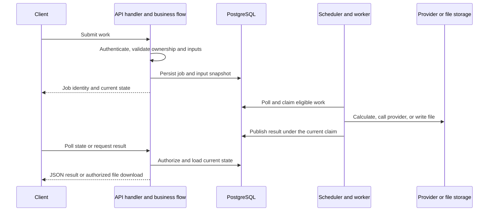

# Background jobs from request to result

Background jobs let the backend accept work before an expensive calculation, file operation, or provider interaction finishes. PostgreSQL stores the durable work and its progress; Go schedulers started by `main.go` find and execute it. Clients then poll an authenticated endpoint, download a generated file, or read the campaign or bundle data updated by the worker.

This guide covers targeting calculations, AI tag evaluation, campaign sending and delivery checks, action uploads, report exports, short-link publication, performance aggregation, and refunds. These families have different states and recovery rules. There is no single generic jobs API or Redis job queue driving all of them.

## How a job moves through the backend



The diagram describes the common pattern. Short-link uploads also attempt processing inside the request. Campaign execution uses campaign claims and delivery checkpoints. AI evaluation uses durable events and a bundle execution lock rather than the same lease mechanism as calculation jobs.

The layers are:

| Layer | Responsibility | Source |
| --- | --- | --- |
| Router | URL, HTTP method, customer/admin/bot authentication | [routes.go](../../app/router/routes.go) |
| Handler | Bind input, obtain authenticated identity, return HTTP response | [campaign handler](../../app/handlers/campaign_handler.go), [bundle handler](../../app/handlers/bundle_handler.go) |
| Business flow | Ownership, input snapshots, reuse, state rules, result publication | [business_flow](../../business_flow) |
| Repository | Durable rows, lookups, claims, guarded updates | [repository](../../repository) |
| Scheduler | Poll, enforce concurrency, start execution, handle shutdown | [app/scheduler](../../app/scheduler) |
| Startup | Construct dependencies and start enabled schedulers | [main.go](../../main.go) |

A **claim** gives a worker permission to process a row. A **lease** limits how long that claim is considered live. A **fenced update** checks the claim timestamp or token before saving, so an older worker cannot overwrite a newer attempt. A crash normally leaves durable work available for recovery after its lease becomes stale. A recorded terminal failure has its own rules; it is not automatically retried by every queue.

## Endpoint map

All paths below start with `/api/v1`. Campaign `:uuid` values are campaign UUIDs; bundle `:id` and action `:file_id` values are numeric IDs. Calculation IDs are numeric; report and short-link upload job IDs are UUID strings. The report request body uses **numeric campaign IDs**.

Customer routes require customer authentication and ownership. Admin routes require admin authentication and authorization. Bot routes require bot authentication.

| Work | Endpoint that starts it | How the result is read |
| --- | --- | --- |
| AI bundle tag evaluation | `POST /bundles/:id/tag-evaluations` | `GET /bundles/:id/tag-evaluation`, then `GET /bundles/:id/tag-scores` |
| Exact smart-targeting capacity | `POST /campaigns/:uuid/smart-targeting/capacity-calculations` | `GET` on the same path for current work, or append `/:calculation_id` |
| Smart-targeting test sample | `POST /campaigns/:uuid/smart-targeting/test-sampling-preview` | `GET` on the same path, or append `/:calculation_id` |
| Smart-targeting execution audience | `POST /campaigns/:uuid/smart-targeting/execution-audience-calculations` | `GET` on the same path, or append `/:calculation_id` |
| Campaign delivery | Customer creates with `POST /campaigns/`, finalizes with `PUT /campaigns/:uuid`; admin approves with `POST /admin/campaigns/approve` | Customer `GET /campaigns/`, campaign exports and click reports; operational bot endpoints described below |
| Provider delivery-status collection | Created internally after sending; no public enqueue endpoint | Campaign statistics and reports |
| Bundle action-file processing | `POST /bundles/:id/action-files` | `GET /bundles/:id/action-files/:file_id` or list; summary and metric routes below |
| Bundle action-file deletion | `DELETE /bundles/:id/action-files/:file_id` | Poll the file and read refreshed metrics |
| Large audience Excel report | `POST /campaigns/audience-click-report/jobs` | `GET /campaigns/audience-click-report/jobs/:id`, then `GET .../:id/download` |
| Admin short-link CSV upload | `POST /admin/short-links/upload-csv` | `GET /admin/short-links/upload-csv/:id`; admin scenario downloads |
| Tag performance refresh | Internal discovery from campaign delivery/status/click changes | Tag-selection and bundle performance read models |
| Undelivered campaign refund | Database trigger on transition to `executed`, plus historical discovery | Wallet balance, transaction history, campaign financial state |
| Short-link mapping/click synchronization | Internal periodic scan when external short links are enabled | Published redirects, local click records and reports |

The first four enqueue endpoints, action upload/deletion, and report creation return `202 Accepted` on success. This confirms acceptance, including reuse of existing calculations where supported. It does not mean work is complete. Short-link upload returns `201` when processing finishes during the request and otherwise `202`; inspect the returned job state in either case.

### Where durable work is stored

| Family | Main database records |
| --- | --- |
| AI evaluation | `bundle_tag_evaluation_runs`, related events/batches/attempts, and `bundle_tag_scores` |
| Capacity | `campaign_targeting_capacity_calculations` |
| Test sampling | `campaign_targeting_test_sampling_calculations`, with separate private selection/reservation records |
| Execution proposal | `campaign_targeting_execution_calculations` and `campaign_targeting_execution_calculation_members` |
| Delivery | Campaign lifecycle and execution checkpoints, processed campaigns, platform send records, and `campaign_status_jobs` |
| Action upload | `bundle_action_files`, `bundle_action_file_uids`, and derived action metrics |
| Audience export | `campaign_audience_report_jobs`, attempt staging rows, and generated files |
| Short-link upload | `admin_short_link_upload_jobs`, local short-link allocation records, and external publication |
| Tag performance | `campaign_tag_test_reports`, campaign/tag performance rows, and summary projections |
| Refunds | `campaign_refund_reconciliation_jobs` and discovery cursor state; accounting remains in wallet transactions |

The uploaded action file and generated report bytes live on disk. Short-link source CSV bytes live in the job row. A database backup alone therefore does not preserve all inputs and downloadable artifacts.

## AI bundle tag evaluation

**Purpose:** score how well active tags fit a bundle persona. This prepares scores for tag discovery and selection; it does not send a campaign.

1. `POST /bundles/:id/tag-evaluations` validates ownership, feature configuration, an existing active run, and the customer's daily quota. It snapshots the persona, prompts, model settings and batch size into `bundle_tag_evaluation_runs`, with a created event.
2. `BundleTagEvaluationScheduler` lists pending runs and executes them under a bundle-scoped execution lock. Both `SMART_TAG_EVALUATION_ENABLED` and `SMART_TAG_EVALUATION_SCHEDULER_ENABLED` must be enabled. Request creation also rejects disabled evaluation/scheduler configuration.
3. The flow analyzes the persona, snapshots active tags into batches, calls the model, validates responses, and stores attempts, events and scores. Retries are bounded by the run's saved configuration.
4. Recovery can reuse successful saved responses and already-persisted batch scores. Completion verifies score coverage before recording the completed event.
5. Poll `GET /bundles/:id/tag-evaluation`; read scores through `GET /bundles/:id/tag-scores`. The bundle-facing statuses include `not_evaluated`, `evaluating`, `evaluated`, `update_required`, and `error`. Status is derived from evaluation history/read models, rather than a universal job-status column.

The scheduler gives an execution a 60-minute context. `SMART_TAG_EVALUATION_SCHEDULER_POLL_INTERVAL` and `SMART_TAG_EVALUATION_SCHEDULER_MAX_PARALLEL_RUNS` control polling and concurrent runs; batch concurrency is configured separately. Provider HTTP success alone is insufficient: malformed or invalid model output can still fail evaluation.

Sources: [flow](../../business_flow/bundle_tag_evaluation_flow.go), [scheduler](../../app/scheduler/bundle_tag_evaluation_scheduler.go), [evaluation guide](bundle-tag-evaluation-flow.md), [repository guide](bundle-tag-evaluation-repository.md).

## Smart targeting calculations

All three calculation families persist input snapshots. Start requests can reuse existing work when the effective input is unchanged. Polling by ID answers what happened to that generation; polling the collection/current path helps recover after a browser reload or lost ID.

### Exact capacity

**Question answered:** how many unique recipients are usable under this campaign's targeting constraints and bundle usage?

`POST /campaigns/:uuid/smart-targeting/capacity-calculations` accepts an optional score-class selection. The flow locks the campaign, snapshots selected tags, classes, platform, allowed colors and phase, then stores a `calculating` generation. The worker scans eligibility and stores raw, eligible, deduction and usable counts plus an allocation fingerprint.

States are `calculating -> calculated` or `failed`. Superseded active work is failed with a reason. The queue uses `started_at` as its claim identity; completion and failure require the matching claim. Capacity counts do not reserve recipients.

Poll the collection path or `.../capacity-calculations/:calculation_id`. A `calculated` result can become stale after input, allocation, expiry or algorithm-version changes. Read the response's currentness/recalculation fields before using it.

Sources: [flow](../../business_flow/smart_targeting_capacity_flow.go), [scheduler](../../app/scheduler/smart_targeting_capacity_scheduler.go), [repository guide](campaign-targeting-capacity-repository.md).

### Test sampling

**Question answered:** which actual recipients satisfy each selected tag's test sample, and what will that sample cost?

`POST /campaigns/:uuid/smart-targeting/test-sampling-preview` starts work for an owned smart-targeting **test** campaign. Inputs come from the saved campaign and ordered tag selection. The worker selects per-tag audiences without duplicates across tags, computes satisfied tags, effective audience and cost, and publishes a durable private selection and sampling intent.

States are `calculating -> calculated` or `failed`, with claim-timestamp guards. This has its own worker pool and can run before an exact-capacity generation exists. Tag order matters when audiences overlap.

Poll the preview path or append `/:calculation_id`. Finalization later rechecks eligibility and reserves the preview's exact members. A preview can become stale; it is not a permanent reservation or a sent-message list.

Sources: [flow](../../business_flow/smart_targeting_sampling_flow.go), [scheduler](../../app/scheduler/smart_targeting_test_sampling_scheduler.go), [sampling guide](smart-targeting-sampling-flow.md).

### Execution audience calculation

**Question answered:** which concrete recipients can be proposed for a smart-targeting **execution** campaign?

`POST /campaigns/:uuid/smart-targeting/execution-audience-calculations` queues an expensive selection for an editable execution campaign. It requires the appropriate current exact-capacity result. The worker scans and persists immutable proposal members without consuming audience capacity or funds.

States are `pending`, `ready`, `failed`, `stale`, and `committed`. A ready proposal is finalizable only while `is_current=true` and `recalculation_required=false`.

Finalization uses the same campaign update endpoint:

```http
PUT /api/v1/campaigns/<campaign-uuid>
Authorization: Bearer <customer-token>
Content-Type: application/json

{"finalize":true,"execution_audience_calculation_id":123}
```

The ID must identify the exact ready proposal. Finalization revalidates inputs under locks, commits the proposal as the active reservation, and coordinates financial state. Delivery preparation later materializes the reserved members into bundle audience selection. Approval alone does not repeat the expensive audience scan.

Sources: [flow](../../business_flow/smart_targeting_execution_calculation_flow.go), [scheduler](../../app/scheduler/smart_targeting_execution_calculation_scheduler.go), [model](../../models/campaign_targeting_execution_calculation.go), [update DTO](../../app/dto/campaign_dto.go).

### Calculation workers and timing

In [main.go](../../main.go), all three calculation schedulers poll every **5 seconds**. Capacity has **2** concurrent slots; test sampling and execution calculation each default to **1**, controlled by their respective `SMART_TARGETING_*_MAX_PARALLEL_RUNS` variables. These are per-process limits.

The shared [scheduler constants](../../app/scheduler/shared.go) give calculation work a **60-minute timeout** and treat a claim as stale after **70 minutes**. The database claim operation uses row locking and `SKIP LOCKED`; each completion must still own its claim. A crashed calculation can therefore remain visibly pending until the stale window passes.

Enable each family with `SMART_TARGETING_CAPACITY_SCHEDULER_ENABLED`, `SMART_TARGETING_TEST_SAMPLING_SCHEDULER_ENABLED`, and `SMART_TARGETING_EXECUTION_CALCULATION_SCHEDULER_ENABLED`. When the latter two are omitted, configuration inherits the capacity switch for compatibility. Capacity execution is independent of the AI evaluation feature.

## Campaign sending and delivery status

A campaign is a durable business workflow, with additional execution and delivery records. Creating its draft does not immediately send messages.

1. The customer creates and edits a campaign. Smart targeting adds the preparation steps above; standard and Excel targeting have their own audience paths.
2. `PUT /campaigns/:uuid` with `finalize=true` performs lifecycle, targeting and budget checks and moves the campaign to `waiting-for-approval`, with the relevant financial reservation.
3. An authorized admin calls `POST /admin/campaigns/approve`. Approval checks schedule, budget and relevant audience state.
4. When due, the appropriate SMS, Bale, Rubika or SPlus scheduler prepares and claims the campaign, obtains/materializes the audience, sends through its provider and records durable send intent and outcomes.
5. Provider acceptance is followed by asynchronous delivery-status collection. Campaign execution finishing does not establish that every recipient received the message.
6. Statistics, click reports, tag performance and eventual refunds consume those results on their own schedules.

Operational bot APIs also participate in this lifecycle: `GET /bot/campaigns/ready`, `POST /bot/campaigns/:id/running`, `POST /bot/campaigns/:id/executed`, `POST /bot/campaigns/:id/statistics`, `POST /bot/campaigns/:id/audience-uids`, and `GET /bot/campaigns/:id/target-audience-excel-file`. These require bot credentials; they are not customer job-polling endpoints.

`CAMPAIGN_EXECUTION_ENABLED` starts all four platform schedulers and their status workers. `CAMPAIGN_EXECUTION_INTERVAL` defaults to one minute. The process shares `CAMPAIGN_EXECUTION_MAX_PARALLEL_RUNS` (default 2) across platforms for bulk execution preparation; SMS additionally has configurable batch-send concurrency. Increasing process replicas multiplies local concurrency.

### Delivery status jobs

After sending, workers create `campaign_status_jobs` carrying platform/provider, tracking IDs, processed-campaign identity and scheduled check times. Platform status workers query due jobs, call providers and persist delivery results/statistics. There is no customer endpoint that creates these rows directly.

Status timings differ by platform and provider. For example, the current SMS code schedules checks at 30 minutes, 1 hour, 2 hours, 6 hours, 12 hours and 88 hours; Candoo replaces the final offset with 18 hours. These values come from executable code; nearby comments contain different older timings.

The status repository selects unexecuted jobs with fewer than three retries. Its due-list methods are reads rather than lease claims. SMS adds its own status-job coordination; do not assume the generic leased-calculation guarantees apply to every platform. `DeliveryStatusFinal` requires at least one job and all jobs executed without error.

### Recovery after an interrupted send

Campaign recovery examines durable delivery intent across attempts. With no intent, stale work can be requeued. If intent exists, the campaign becomes `interrupted` to avoid replaying a provider call that may already have succeeded. Investigate provider/tracking records before attempting operational recovery.

Customer-facing results are available through `GET /campaigns/`, `GET /campaigns/:uuid/export`, and `GET /campaigns/:uuid/click-report`, plus the audience-report job API below. These reads expose business results; there is no generic public execution-job resource.

Sources: [campaign lifecycle](campaign-lifecycle.md), [execution repository guide](campaign-execution-repository.md), [SMS scheduler](../../app/scheduler/sms_campaign_scheduler.go), [status repository guide](campaign-status-job-repository.md).

## Bundle action files

**Purpose:** attribute customer-uploaded action UIDs to delivered bundle audiences and rebuild action metrics.

Upload `multipart/form-data` with `file` and `action_level` to `POST /bundles/:id/action-files`. `GET /bundles/:id/action-files/template` provides the template.

1. The API checks ownership, `.xlsx` extension, nonempty content and a 50 MiB upload limit. It writes staged bytes and creates a non-claimable `staging` row.
2. It renames the file into durable storage, then promotes the row to `pending`. The API returns `202`; parsing happens later.
3. `BundleActionFileScheduler` claims work, setting `processing` and a claim timestamp. The worker parses the first worksheet, deduplicates UIDs, validates attribution and full delivery, and stores counts/results.
4. Fenced completion marks it `processed` and rebuilds metrics; parse failures become `failed`.
5. `DELETE /bundles/:id/action-files/:file_id` accepts a processed file and queues `delete_pending`; the worker completes deletion and metric changes, ending at `deleted`.

Poll the file endpoint or list. Read business results from `GET /bundles/:id/action-summary`, `GET /bundles/:id/action-tag-metrics`, and `GET /campaigns/:uuid/action-metrics`. An uploaded UID may be valid syntactically but ineligible for attribution.

Enable with `BUNDLE_ACTION_FILE_SCHEDULER_ENABLED`. Configuration defaults are a one-minute poll, 2 parallel jobs, a 30-minute timeout and a 35-minute lease. The Go configuration defaults this worker to disabled, while beta Compose defaults its flag to true. Storage uses `BUNDLE_ACTION_FILE_STORAGE_ROOT` or `data/uploads/bundle-action-files`.

Sources: [flow](../../business_flow/bundle_action_flow.go), [scheduler](../../app/scheduler/bundle_action_file_scheduler.go), [action guide](bundle-action-flow.md).

## Large campaign audience reports

**Purpose:** build a potentially large Excel workbook outside the HTTP request and serve it later through an authorized download.

```http
POST /api/v1/campaigns/audience-click-report/jobs
Authorization: Bearer <customer-token>
Content-Type: application/json

{"campaign_ids":[101,102]}
```

The request accepts 1–100 unique positive numeric campaign IDs, all owned by the customer. Creation enforces a serialized per-customer limit and returns `202` with the job UUID.

The worker claims `pending` work or an expired `processing` lease using a fresh UUID token. It rechecks campaign ownership, stages audience UID/code data from durable campaign files, then writes a streamed workbook with click/action information. Attempt-specific partial and final filenames keep competing attempts separate. Completion publishes the file path, row count, sheet count and size under the matching token.

```text
pending -> processing -> completed -> expired
                      -> failed
```

Poll `GET /campaigns/audience-click-report/jobs/:id`. Once completed, call `GET /campaigns/audience-click-report/jobs/:id/download` with customer authentication. The handler rechecks access and expiry and serves the stored file with Excel content type and an attachment filename. The server filesystem path is never serialized to the client.

Download behavior is `409` before readiness, `410` after expiry, and `404` for absent/unavailable output. Successful output expires **24 hours after completion**. Scheduled cleanup expires outputs, removes old files/orphans, and eventually purges old terminal metadata. A failed job is terminal for normal generation errors; automatic lease recovery handles interrupted processing, not arbitrary failed rows.

`CAMPAIGN_AUDIENCE_REPORT_SCHEDULER_ENABLED` defaults true. Go configuration defaults to a one-minute poll, 2 parallel runs, a 6-hour job timeout, a 6-hour-15-minute lease, 10 million rows, 5 GiB maximum output and 100 retained active jobs per customer. Pending/processing jobs and completed unexpired jobs count toward that customer limit. Storage is configured by `CAMPAIGN_AUDIENCE_REPORT_STORAGE_ROOT`.

The staged audience belongs to the export attempt, while click/action data is looked up as output pages are written. Treat the workbook as a generated report rather than one database-wide snapshot of every event.

The older `POST /campaigns/audience-click-report` is a separate synchronous export route. Use the `/jobs` API when the client needs asynchronous generation and later download.

Sources: [handler](../../app/handlers/campaign_handler.go), [DTO](../../app/dto/campaign_dto.go), [flow](../../business_flow/campaign_audience_report_job_flow.go), [scheduler](../../app/scheduler/campaign_audience_report_scheduler.go), [repository guide](campaign-audience-report-job-repository.md).

## Admin short-link upload and synchronization

`POST /admin/short-links/upload-csv` accepts multipart `file`, `short_link_domain`, and `scenario_name`; the CSV must contain `long_link`. The flow saves source CSV bytes, a reserved scenario ID and a stable allocation key in `admin_short_link_upload_jobs`.

The request immediately attempts processing and may wait through transient failures within its request deadline. It returns `201` if completed, otherwise `202` with the current nested job. Poll `GET /admin/short-links/upload-csv/:id` and inspect status, created/skipped/published counts, attempts, next attempt and last error.

The background loop starts when `EXTERNAL_SHORTLINK_ENABLED=true`, runs immediately, then every minute. It selects up to 20 due jobs per pass and processes them sequentially. Claims use UUID tokens and lease expirations. States include `pending`, `processing`, `retrying`, `completed`, and `failed`. Transient failures schedule another attempt; permanent input/allocation errors fail. Recovered work reuses the allocation key and existing local codes to avoid allocating a second set.

Results become usable short links and scenario downloads through the admin `/short-links/download*` endpoints. Upload completion and downstream click reporting have separate lifecycles.

Two additional schedulers run under the same external-shortlink feature flag:

| Scheduler | Work | Interval setting |
| --- | --- | --- |
| Mapping sync | Publish pending local mappings to the external redirect service | `EXTERNAL_SHORTLINK_MAPPING_SYNC_INTERVAL`, template 1 minute |
| Click sync | Import external click pages and advance synchronization progress | `EXTERNAL_SHORTLINK_CLICK_SYNC_INTERVAL`, template 5 minutes |

These scans do not expose a generic customer job ID. Their outputs feed redirect availability and local reports. The external service also has its own runtime, described in its [README](../../external-shortlink/README.md).

Sources: [admin flow](../../business_flow/admin_short_link_flow.go), [job repository](../../repository/admin_short_link_upload_job_repository.go), [admin handler](../../app/handlers/short_link_admin_handler.go), [startup](../../main.go).

## Derived performance and refund workers

### Tag performance refresh

`TagTestPerformanceScheduler` discovers smart-targeted campaigns affected by clicks, sending progress, status updates, missing reports or calculation-version changes. Despite its historical name, it handles both test and execution phases.

It claims report work with `started_at`, recomputes full campaign history, then updates campaign/tag and bundle/phase summaries under database locks. These projections feed tag-selection and bundle read models. They can lag source delivery/click records until the next pass.

`TAG_TEST_PERFORMANCE_SCHEDULER_ENABLED` defaults false in Go configuration. The interval defaults to one minute, batch size 25; the scheduler processes claimed reports sequentially. Recompute timeout is 2 minutes, stale-lease duration 30 minutes, and retry delay grows from one minute up to one hour for retryable failures. Invalid campaigns are handled separately from transient failures.

Sources: [scheduler](../../app/scheduler/tag_test_performance_scheduler.go), [repository guide](tag-test-performance-repository.md).

### Refund reconciliation

A database trigger atomically inserts `campaign_refund_reconciliation_jobs` when a campaign transitions to `executed`. Historical discovery backfills missing work using a durable cursor. There is no public enqueue endpoint. Invalid schedules produce `manual_review` work.

The worker waits for eligibility, claims a lease, calls `ReconcileUndeliveredCampaignRefund`, and records `completed`, `retry`, or `manual_review`. The business flow performs the accounting decision; the queue repository only coordinates work. No-refund-needed cases complete successfully. Results appear in wallet/transaction and campaign financial data.

`CAMPAIGN_REFUND_RECONCILIATION_SCHEDULER_ENABLED` operates independently of campaign sending. Defaults are a one-minute poll, eligibility **72 hours after the campaign's scheduled time**, one parallel run, 30-second timeout, 2-minute lease and 8 maximum attempts. Retry delay grows from one minute up to one hour; exhausted attempts or accounting inconsistencies require manual review.

Sources: [enqueue trigger](../../migrations/0153_enforce_campaign_refund_queue.sql), [scheduler](../../app/scheduler/campaign_refund_reconciliation_scheduler.go), [repository guide](campaign-refund-reconciliation-repository.md), [campaign flow](../../business_flow/campaign_flow.go).

## Process ownership and storage

The same backend binary can serve HTTP and run workers. Startup flags determine which workers each process owns; a healthy API does not establish that every queue has a consumer. The shutdown path calls registered stop functions to cancel workers and wait for them.

The production helper [deploy-campaign-scheduler-beta.sh](../../scripts/deploy-campaign-scheduler-beta.sh) creates a private campaign scheduler from the API container's effective environment:

| Work | API process | Isolated campaign scheduler |
| --- | --- | --- |
| Campaign sending and provider status | Required off by the helper | Explicitly enabled |
| Capacity, test sampling, execution calculations | Owned according to API flags | Explicitly disabled |
| AI evaluation, tag performance, refunds | Owned according to API flags | Explicitly disabled |
| Action-file processing | Owned according to API flag | Explicitly disabled |
| External short-link upload/mapping/click workers | Owned according to API feature flag | Explicitly disabled |
| Audience-report generation | API flag | **Inherited flag; not explicitly disabled by this helper** |

The last row is a concrete deployment caveat. Beta Compose mounts `uploads_beta` at `/data` in the API; the isolated helper mounts its separate scheduler log volume at `/data`. With report generation enabled in the inherited environment, the isolated process can claim a report whose inputs or output are unavailable to the API. The same absolute pathname does not imply shared bytes. Keep report execution on a process with the API's required shared artifacts, or provide appropriately shared storage before distributing this queue.

More generally, database access is sufficient for coordination but not for file access. Action workers need uploaded workbooks; report workers need campaign audience files and output storage; API downloads need the completed output. Multiple hosts require shared artifact storage or explicit worker ownership. Per-process concurrency limits also multiply across replicas.

Configuration defaults, template examples and Compose defaults sometimes differ. Use the effective process environment together with [config/production.go](../../config/production.go), [docker-compose.beta.yml](../../docker-compose.beta.yml), and the deployment helper when diagnosing ownership.

The process also starts periodic operational work that has no customer job resource. For example, Payam balance monitoring runs inside the campaign-execution branch when `PAYAM_BALANCE_MONITOR_ENABLED` is enabled, checks provider balance, and sends alerts. Its default interval is five minutes. Such a timer differs from a durable queued calculation: there is no creation endpoint or job result to poll.

## Client workflow from start to finish

For a calculation or file-producing job:

1. Submit once with the correct authenticated identity and record the returned job/calculation ID.
2. Show its returned state. An accepted response or upload receipt is not a completed result.
3. Poll the documented GET endpoint at a bounded interval; increase the delay during long runs. This is client behavior, not an API-enforced polling interval.
4. For calculations, check freshness as well as success. For exports, check status and expiry before downloading.
5. Consume the result through the authenticated API. Calculation/member snapshots are consumed by later backend flows; they are not public filesystem URLs.
6. On terminal failure, show the API's error code/message. Correct invalid inputs before resubmission. Some start methods reuse work; report submission creates a new export job, so repeated POST requests can consume the customer limit.
7. After reload, use current-calculation lookup where available; for reports and admin uploads, retain the job ID to resume polling.

A full smart-targeting execution commonly follows: create bundle/campaign, optionally evaluate AI tags, select tags, calculate exact capacity, calculate execution audience, poll until ready/current, finalize with that calculation ID, obtain admin approval, wait for scheduled sending, then read progressively updated delivery and click results. A test campaign uses its sampling preview and reservation path instead. Action attribution, large exports, derived performance and refunds happen at their respective later stages.

## Troubleshooting pending or missing results

| Symptom | Check |
| --- | --- |
| Accepted work never starts | Correct worker flag on an actual running process; scheduler startup/claim errors; database connectivity; exhausted local slots |
| Calculation stays pending after restart | `started_at` and the 70-minute stale window; a fresh claim is intentionally protected |
| Calculated result is rejected later | Input hash, tag order/classes/colors, platform/phase, expiry, allocation fingerprint, algorithm version and currentness fields |
| Campaign executed but delivery totals still move | Pending platform/provider status jobs; execution and final delivery status are separate |
| Stale sending campaign becomes interrupted | Durable send intent/checkpoints and provider state; recovery avoids blindly replaying messages |
| Export completed but download returns 404 | File exists on the API's filesystem, shared-volume configuration, inherited report worker in the isolated scheduler |
| Export download returns 409 or 410 | Job is not completed, or output has expired; create a fresh export after expiry |
| Upload accepted but action metrics unchanged | File status and parse/attribution counts; metrics change after processing completes |
| Short-link upload is retrying | External service availability, next-attempt time, last error and publication counts |
| Wallet refund has not appeared | Executed state, scheduled-time eligibility delay, reconciliation attempts and manual-review state |
| Tag metrics lag current clicks | Performance scheduler ownership, discovery cursors, report state and next retry |

Start investigations with the relevant resource ID, campaign/bundle identity, state, claim timestamp/token, attempts and error fields. Follow the queue-specific repository and scheduler rather than assuming one retry policy. The [backend codebase guide](backend-codebase-guide.md) provides the wider architecture and domain map.
